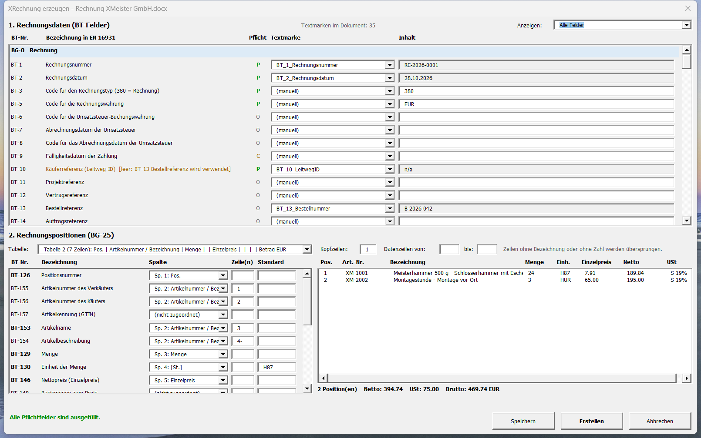

# XRechnung aus Word – Add-In für Word 2019

Für kleine Unternehmen, die ihre Rechnungen bisher mit Word schreiben und nun **XRechnungen** liefern müssen –
ohne die gewohnten Abläufe umzustellen. Die bestehende Rechnungsvorlage bleibt der Master: Sie wird nur um
**Textmarken** ergänzt, die die vorgeschriebenen Felder der XRechnung befüllen. Die XRechnung entsteht danach mit
wenigen Klicks direkt aus der geöffneten Rechnung. Die einmal erarbeitete Zuordnung von Textmarken und
Tabellenspalten wird **direkt in der Vorlage gespeichert** und steht bei jeder weiteren Rechnung wieder zur Verfügung.

Erzeugt wird eine XRechnung 3.0 (EN 16931, Syntax UBL 2.1) als XML-Datei. Der gesamte Code ist VBA im Add-In
`XRechnung.dotm` – keine Installation weiterer Software, keine externen Skripte, keine Cloud.



## Schnellstart

1. `XRechnung.dotm` nach `%APPDATA%\Microsoft\Word\STARTUP` kopieren und Word neu starten.
   Auf der Registerkarte **Start** erscheint die Gruppe **E-Rechnung › XRechnung erzeugen**.
2. `beispiel\Rechnung XMeister GmbH.docx` öffnen und **XRechnung erzeugen** klicken.
3. **Erstellen** – die XRechnung wird als `Rechnung XMeister GmbH.xml` neben dem Dokument gespeichert.

Der STARTUP-Ordner ist standardmäßig ein vertrauenswürdiger Speicherort, die Makros laufen also ohne Warnung.
Alternativ: *Datei › Optionen › Add-Ins › Verwalten: Vorlagen › Hinzufügen…* oder *Alt+F8* › `XRechnungErzeugen`.

## Inhalt des Repositorys

| Datei / Ordner | Zweck |
|---|---|
| `XRechnung.dotm` | Das Add-In |
| `beispiel\Rechnung XMeister GmbH.docx` | Beispielrechnung einer fiktiven Firma mit Textmarken und gespeicherter Zuordnung |
| `beispiel\Rechnung XMeister GmbH.xml` | Daraus erzeugte XRechnung |
| `export\` | VBA-Dateien (.bas/.cls/.frm/.frx) zum manuellen Import in den VBA-Editor |
| `src\`, `build\` | Quelltext (UTF-8) und Build-Skript – nur für die Weiterentwicklung |

## Eigene Vorlage einrichten

1. In der eigenen Rechnungsvorlage die Inhalte markieren und als Textmarke einfügen (*Einfügen › Link › Textmarke*).
   Am einfachsten mit Namen nach dem Schema `BT_<Nr>_<Text>`, z. B. `BT_1_Rechnungsnummer`, `BT_44_Kaeufer`,
   `BT_84_IBAN` – solche Textmarken ordnet das Add-In automatisch dem passenden BT-Feld zu.
   Textmarken dürfen auch Seriendruckfelder (MERGEFIELD) oder Datumsfelder umschließen; verwendet wird das angezeigte Ergebnis.
2. **XRechnung erzeugen** öffnen, fehlende Zuordnungen in der Liste wählen, feste Angaben (z. B. Ländercode)
   direkt eintragen und die Positionstabelle mit ihren Spalten zuordnen.
3. **Speichern** – die Zuordnung liegt nun als Dokumenteigenschaft **XRechnung** in der Vorlage.
   Alle Rechnungen, die aus dieser Vorlage entstehen, bringen sie mit.

Welche BT-Felder Pflicht sind, zeigt der Dialog: ein rotes **P** heißt „fehlt noch“.

## Bedienung

**Tabelle 1 – Rechnungsdaten (BT-Felder)**: alle Felder der Rechnungsebene (BT-1 … BT-165) mit BT-Nr.,
Bezeichnung nach EN 16931, Pflicht, Textmarke und Inhalt.

* **Textmarke**: Liste aller Textmarken im Dokument. Bei `(manuell)` wird der Inhalt direkt eingetippt.
* **Pflicht**: `P` Pflicht, `O` optional, `C` bedingt. Ein `P` ist **rot**, solange kein Inhalt vorliegt, sonst **grün**.
* Die Summen (BT-106 … BT-119) werden aus den Positionen **berechnet** (blau hinterlegt). Ist dort eine Textmarke
  gewählt, wird deren Wert mit der Berechnung verglichen („stimmt überein“ bzw. rot „ABWEICHUNG“).
* **Anzeigen** filtert die Liste, z. B. nach *Fehlende Pflichtfelder*.

**Tabelle 2 – Rechnungspositionen**:

* **Tabelle**: die Positionstabelle im Dokument (wird automatisch vorgeschlagen).
* **Kopfzeilen / Datenzeilen von–bis**: Bereich der Positionszeilen. Leer- und Summenzeilen werden übersprungen.
* **Spalte / Zeile(n)**: Quellspalte je Positionsfeld. **Zeile(n)** wählt Absätze innerhalb einer Zelle:
  leer = alle, `1` = erste, `2-3`, `4-` = ab der vierten. In der Beispielvorlage stehen in Spalte 2
  Artikelnummer (1), Käufer-Artikelnummer (2), Name (3) und Beschreibung (4-).
  Vorangestellte Bezeichner wie „Ihre Artikelnummer:“ werden bei Kennungen entfernt.
* **Standard**: Wert, wenn die Zelle leer ist (z. B. Einheit `H87`, USt-Kategorie `S`, Satz `19`).
  Einheiten wie „St.“, „h“, „Std“, „kg“, „psch“ werden in UN/ECE-Codes umgesetzt.

**Buttons**

* **Erstellen** ist erst aktiv, wenn alle Pflichtfelder gefüllt sind und Positionen erkannt wurden. Vorher werden
  die Geschäftsregeln geprüft (u. a. BR-DE-16, BR-DE-23, BR-CO-25, BR-CO-26, Steuerkategorien). Die Datei erhält den
  Namen des Dokuments mit der Endung `.xml` und liegt im selben Ordner.
* **Speichern** legt Zuordnung und Eingaben als benutzerdefinierte Dokumenteigenschaft **XRechnung** ab
  (Word begrenzt Texteigenschaften auf 255 Zeichen, längere Zuordnungen werden in `XRechnung_2`, `XRechnung_3`, … fortgesetzt).
* **Abbrechen** schließt ohne Änderungen.

## Hinweise

* **Firmen und Behörden mit einer Vorlage**: BT-10 (Käuferreferenz) ist Pflicht. Bei Behörden gehört dort die
  Leitweg-ID hinein, bei Firmenkunden die vom Kunden vorgegebene Referenz. Ist BT-10 leer, verwendet das Add-In die
  **Bestellnummer (BT-13)** und weist beim Erstellen darauf hin. Behörden geben oft Leitweg-ID *und* Bestellnummer
  vor – deshalb zwei getrennte Felder. In der Beispielvorlage steht bei „Ihre Referenz/Leitweg-ID“ der Platzhalter `n/a`.
* **Platzhalter** wie `n/a`, `-`, `./.` oder `entfällt` in einer Textmarke gelten als leeres Feld.
* **Elektronische Adresse** (BT-34, BT-49): E-Mail-Adresse → Schema `EM`, Leitweg-ID → `0204`,
  oder ausdrücklich `Schema:Kennung` (z. B. `EM:rechnung@firma.de`, `0204:991-12345-67`).
* **Rechnungsdatum**: In der Beispielvorlage ist das Datum ein `TIME`-Feld und zeigt immer das aktuelle Datum.
* **Seriendruck**: Beim Zusammenführen in ein neues Dokument kann Word Textmarken entfernen – dann die Zuordnung im
  Ergebnisdokument prüfen.
* **Stapelverarbeitung**: `XRechnungExportieren([zielPfad])` erzeugt die XRechnung ohne Dialog mit der gespeicherten Zuordnung.
* **Nicht abgebildet**: Anhänge (BG-24), mehrere Nachlässe/Zuschläge auf Dokumentebene (je einer wird unterstützt),
  Preisnachlässe auf Positionsebene (BT-147/148), Artikelattribute (BG-32).

## Prüfung

Die XRechnung in `beispiel\` wurde mit dem KoSIT-Validator 1.6.3 und der Prüfkonfiguration
*XRechnung 3.0.2 (2026-08-31)* geprüft: Szenario *EN16931 XRechnung (UBL Invoice)*, Schema und Schematron ohne
Fehler und Warnungen, **ACCEPTABLE**. Eigene Rechnungen lassen sich ebenso prüfen, z. B. mit dem
[KoSIT-Validator](https://github.com/itplr-kosit/validator) und der
[XRechnung-Konfiguration](https://github.com/itplr-kosit/validator-configuration-xrechnung).

## Entstehung

Add-In, Beispielvorlage und Dokumentation wurden mit [Claude Code](https://claude.com/claude-code)
(Modell Claude Opus 5.5 von Anthropic) entwickelt und in Word 2019 sowie mit dem KoSIT-Validator getestet.

## Lizenz

[MIT](LICENSE) – Nutzung auf eigene Verantwortung. Das Add-In prüft die wichtigsten Geschäftsregeln, ersetzt aber
keine Prüfung der erzeugten XRechnung durch den Rechnungssteller.

## Neu bauen

```powershell
.\build\Build-AddIn.ps1
```

Voraussetzungen: Word ist geschlossen, und unter *Trust Center › Makroeinstellungen* ist
*Zugriff auf das VBA-Projektobjektmodell vertrauen* aktiviert (nur für den Build, nicht für die Nutzung).
Das Skript startet Word mit neutralem TEMP-Ordner und entfernt Autor, Bearbeitungszeit und Bearbeitungs-IDs aus der
`.dotm`, damit keine Angaben zur eigenen Arbeitsumgebung im Add-In landen.
